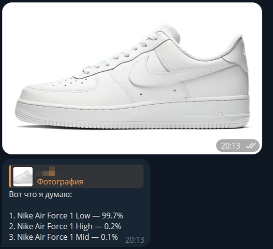

#  Sneaker Classifier Telegram Bot


Telegram-бот на базе компьютерного зрения (PyTorch), который распознаёт **50 популярных моделей кроссовок** по фотографии и выдаёт **Top-3 наиболее вероятных варианта** с оценкой уверенности модели в процентах.

---



## Особенности реализации

* **Transfer Learning на базе ResNet-18:** использованы предобученные веса `ImageNet` (`ResNet18_Weights.DEFAULT`) с кастомным классификатором (`Dropout(0.3)` + `Linear(512, 50)`) и полным дообучением (fine-tuning) слоёв под текстуры и силуэты обуви.
* **Устойчивость к ракурсам и свету:** пайплайн обучения включает аугментации (`RandomHorizontalFlip`, `RandomRotation`, `ColorJitter`) и стратифицированное разбиение выборки (`stratify` 80/20), сохраняющее баланс классов.
* **In-Memory инференс без лишних файлов на диске:** фотографии из Telegram обрабатываются на лету через байтовый поток `io.BytesIO` без сохранения временных изображений в файловую систему.
* **Кроссплатформенность (CUDA / CPU):** обучение рассчитано на GPU, а инференс бота легко работает даже на обычном CPU (время ответа — доли секунды).

---

## Стек технологий

* **Deep Learning:** `PyTorch`, `Torchvision`
* **Обработка данных и изображений:** `Pillow (PIL)`, `scikit-learn`
* **Telegram-бот и окружение:** `pyTelegramBotAPI (telebot)`, `python-dotenv`
* **Датасет:** [Popular Sneakers Classification (Kaggle)](https://www.kaggle.com/datasets/nikolasgegenava/sneakers-classification) — ~6 000 изображений, 50 классов.

---

##  Структура проекта

```text
tg_sneakers/
├── bot.py              # Точка входа Telegram-бота (обработка сообщений и фото)
├── predict.py          # Класс SneakerClassifier для инференса и выдачи Top-3 предсказаний
├── model.py            # Архитектура нейросети (ResNet-18 + кастомный head)
├── train.py            # Скрипт подготовки данных, обучения и валидации модели
├── classes.json        # Список из 50 распознаваемых классов кроссовок
├── requirements.txt    # Зависимости проекта
├── .env                # Токен бота (не индексируется в Git)
└── .gitignore          # Исключения для Git (веса, датасет, секреты)
```

---

## Установка и запуск

### 1. Клонирование репозитория и установка зависимостей
```bash
git clone https://github.com/VakulenkoIvan/Sneaker-Classifier.git
cd Sneaker-Classifier
pip install -r requirements.txt
```

### 2. Настройка переменных окружения
Создайте файл `.env` в корневой папке проекта и укажите токен от `@BotFather`:
```env
BOT_TOKEN=ваш_токен_телеграм_бота
```

### 3. Подготовка весов модели (`best_model.pth`)
Поместите обученные веса `best_model.pth` в корень проекта или запустите обучение самостоятельно (поместив датасет в папку `sneakers-dataset/`):
```bash
python train.py
```

### 4. Запуск бота
```bash
python bot.py
```

---

## Поддерживаемые бренды и модели (50 классов)

Модель обучена различать классические и популярные силуэты:
* **Nike & Jordan:** Air Force 1 (Low / Mid / High), Dunk (Low / High), Air Jordan (1 Low & High, 3, 4, 11), Air Max (1, 90, 95, 97, 270, Plus TN), VaporMax, Blazer Mid '77, Cortez
* **Adidas & Yeezy:** Samba, Gazelle, Superstar, Stan Smith, Forum (Low / High), Ultraboost, NMD R1, Yeezy Boost 350 V2, Yeezy 700 Wave Runner, Yeezy Slide
* **New Balance:** 327, 550, 574, 990, 992
* **Converse & Vans:** Chuck Taylor All-Star (Low / High), Chuck 70 (Low / High), One Star, Old Skool, Sk8-Hi, Authentic, Slip-On Checkerboard
* **Другие бренды:** Asics Gel-Lyte III, Puma Suede Classic, Reebok Club C 85, Reebok Classic Leather, Salomon XT-6